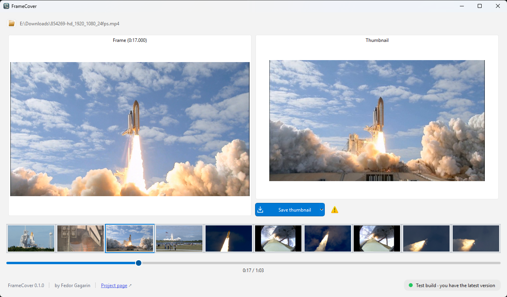

# FrameCover

Many video players and file managers generate a thumbnail by grabbing the first frame of the video — which is often a black screen, a title card, or a fade-in. This tool lets you scrub to any frame you like and embed it as the video's cover art, so the thumbnail actually shows something meaningful.

Built with Python 3.13, PySide6 (Qt6), and PyAV.

**Supported formats:** MP4, MOV, MKV, WebM, AVI, FLV

---

## What it looks like

### Before (original thumbnail)


### Application



### After (updated thumbnail)


---

## Quick start

```bash
python3.13 -m venv .venv
source .venv/bin/activate        # Linux / macOS
# .venv\Scripts\activate         # Windows
pip install -e ".[dev]"
framecover
```

---

## Requirements

- Python 3.13+
- [uv](https://github.com/astral-sh/uv) or `pip` (for environment setup)

Dependency baseline: PySide6-Essentials 6.12.0, PyAV 19.0.2, Pillow 13.0.0,
imageio-ffmpeg 0.6.0, and mutagen 1.48.1. Exact runtime and development versions
are recorded in `uv.lock`; use `uv sync --frozen --extra dev` to reproduce them.
The upgraded stack was validated on Windows with Python 3.14, including native
PyInstaller 6.22.3 packaging and application-window initialization.

---

## Setup

### Create and activate a virtual environment

```bash
python3.13 -m venv .venv
source .venv/bin/activate        # Linux / macOS
# .venv\Scripts\activate         # Windows
```

### Install dependencies

```bash
pip install -e ".[dev]"
```

This installs the application along with all development tools (pytest, ruff, ty, pyinstaller).

The GUI uses `PySide6-Essentials`, which provides the `PySide6` imports needed
by the application and Qt tests without installing the Addons, WebEngine, or PDF
packages. The full `PySide6` metapackage is not required.

When migrating an existing environment from full PySide6, uninstalling its
overlapping packages can remove shared bootstrap files. If Qt imports fail after
`uv sync --frozen --extra dev`, restore the Essentials files:

```bash
uv sync --frozen --extra dev --reinstall-package pyside6-essentials --reinstall-package shiboken6
```

---

## Running the application

```bash
framecover
```

Or directly via the module:

```bash
python -m framecover.app
```

Typical workflow:

1. Open a video file.
2. Scrub the timeline to the frame you want.
3. Click **Save thumbnail** (or press **Ctrl+S**) to save a copy named
   `video-thumbnail.mp4`, leaving the original unchanged.

### Saving copies and overwriting originals

The arrow on the right of the Save button opens two actions: **Save a copy**
(the default) and **Overwrite original…**. Overwriting the original displays a
warning that the program may damage it, with **Save a copy**, **Overwrite**, and
**Cancel** choices. The checkbox suppresses this warning only until the program
restarts. If you have not tested the program on similar files, save a copy.

When a copy's name already exists, choose **Overwrite**, **Add another suffix**
(for example, `video-thumbnail-thumbnail.mp4`), or **Cancel**. Previously saved
copies of the same unchanged source can be updated without confirmation.
The application verifies both files against a hidden receipt next to the copy;
if the receipt is missing or either file has changed, it asks before overwriting.
Keep the receipt with the copy to retain this verification across restarts.

Copying, verification, and thumbnail processing run in the background. A failed
copy save does not replace an existing destination. After saving a copy, the
original stays open for frame selection, so saving again does not accumulate
inserted preview frames. Container limitations still apply: formats without
embedded cover art rely on the platform's thumbnail-cache support.

On filesystems without hard-link support (such as FAT/exFAT), a new copy becomes
visible while its bytes are being written. An interrupted write may leave an
incomplete copy, but does not overwrite an existing file. If another application
changes the destination during a save, recovery backups are retained whenever
they cannot be restored safely; any recovery paths are included in the error.

### Convert other formats to MP4

Opening an unsupported video container (for example M2TS, MTS, or MPEG-TS)
offers to convert it to a separate MP4. Choose **Yes**, then choose where to save
the MP4. Existing destinations require confirmation in the save dialog; the
source file can never be used as the destination.

Conversion runs in the background with a stage indicator. FFmpeg first attempts
to remux the first playable video and all audio tracks without re-encoding.
The result must also support stream-copy preview insertion. If the streams cannot
be stored in MP4 or are incompatible with that path (for example MPEG-2 or HEVC),
the application checks FFmpeg's available encoders and converts to compatible
H.264/AAC during conversion, rather than when saving the thumbnail.
Re-encoding can take time and reduce
quality. Subtitles, additional video streams, attachments, and data tracks are
not transferred. Not every input codec or damaged file can be converted.

The source is left untouched, and failed conversion does not replace an existing
destination. On success, the MP4 opens automatically: select a frame and save its
thumbnail as usual. Saving or replacing its preview encodes only the preview
frame and concatenates it with the copied video; the main video is not re-encoded.
Already supported containers keep their existing workflow.

FFmpeg is supplied by `imageio-ffmpeg`. To use another build with the required
decoders and H.264/AAC encoders, set `IMAGEIO_FFMPEG_EXE` to its executable path
before launching the application. Hardware encoders are tried only if advertised
by that build; if a device cannot initialize, another available encoder is tried.

---

## Running tests

All tests are under `tests/`. Activate the virtual environment first.

### Run unit and integration tests

```bash
pytest tests/unit/ tests/integration/ -q
```

### Run with coverage (≥80% gate)

```bash
pytest --cov=framecover \
       --cov-report=term-missing \
       --cov-fail-under=80 \
       tests/unit/ tests/integration/
```

### Run benchmarks

```bash
pytest tests/benchmarks/ --benchmark-only
```

The benchmarks enforce a 500 ms maximum per extraction for SD, 1080p, and 4K.
Frame extraction uses up to four decoder threads to accelerate seeking.

Linux CI tests use the distribution's FFmpeg via `IMAGEIO_FFMPEG_EXE=ffmpeg`:
the bundled Linux FFmpeg 7.0.2 can crash while reading MPEG-TS inputs.

### Via Makefile

```bash
make test        # unit + integration tests
make coverage    # tests with >=80% coverage gate
make lint        # ruff linter
make typecheck   # ty check (src/ and scripts/)
```

---

## Building a distribution

Single-file executables are produced via [PyInstaller](https://pyinstaller.org).

```bash
make dist-linux    # → dist/linux/framecover
make dist-macos    # → dist/macos/framecover.app
make dist-windows  # → dist/windows/framecover.exe
```

Or manually:

```bash
pyinstaller pyinstaller.spec --distpath dist/linux --workpath build/linux --noconfirm
```

Qt plugins and libraries are collected by PyInstaller's hooks for the imported
Qt modules. Do not collect the entire `PySide6` data directory: it also bundles
unused WebEngine, QML, and development resources.

---

## Changelog and releases

Development dependencies include `git-changelog`. Commit messages follow
[Conventional Commits](https://www.conventionalcommits.org/):
`feat: ...`, `fix: ...`, and `feat!: ...` or a `BREAKING CHANGE:` footer.

```bash
make changelog                 # regenerate CHANGELOG.md, including Unreleased
make release VERSION=0.2.0     # explicit stable version (v0.2.0 also accepted)
make release                  # let git-changelog calculate the next version
```

`make release` requires a clean working tree, a checked-out branch and full Git
history. It generates the changelog, synchronizes the project/package/lockfile
versions, creates a `chore(release): vX.Y.Z` commit and an annotated `vX.Y.Z` tag.
It does **not** push or publish automatically. Review the result, then run:

```bash
git push --atomic origin HEAD refs/tags/v0.2.0
```

Without `VERSION`, version calculation is delegated to `git-changelog`:
features bump minor, fixes bump patch, and breaking changes bump major
(for 0.x versions, git-changelog's default zero-version rules apply).
Before the first version tag, git-changelog determines the initial version;
use `VERSION` to select a different initial release. Only stable `X.Y.Z` versions
are supported, and existing versions cannot be released again.

Pushing a `vX.Y.Z` tag triggers the release workflow. It validates the tag against
the project, package and lockfile versions, generates the full changelog and notes
for that version, then builds natively on Linux, macOS and Windows. After **all
three builds succeed**, it publishes a GitHub Release containing:

- Linux executable in a `.tar.gz` archive.
- macOS `.app` bundle in a `.tar.gz` archive (preserving executable permissions).
- Windows `.exe`.
- Full `CHANGELOG.md`, with the current version's changes in the release body.

The normal branch/PR CI remains separate. Version numbers in the macOS bundle
are read from `pyproject.toml`. GitHub Actions uses `GITHUB_TOKEN` with write
permission only in the publication job; no personal token is required.

If a local release command fails, inspect `git status` before retrying: generated
files or a completed release commit can remain, but the command never pushes.
No release is created while merely installing these tools.

---

## Project structure

```
src/
  framecover/
    app.py          # Entry point
    models.py       # VideoFile, VideoFormat, TimelinePosition
    exceptions.py   # Domain exceptions
    core/           # Video loading, frame extraction, thumbnail writing
    platform/       # OS-specific cache invalidation (Linux, macOS, Windows)
    ui/             # PySide6 widgets (MainWindow, TimelineWidget, workers)
tests/
  unit/             # Unit tests
  integration/      # Integration tests (real video files via PyAV)
  benchmarks/       # pytest-benchmark frame extraction perf tests
```

---

## Landing page (GitHub Pages)

The English-language landing page is published at
<https://fgagarin.github.io/framecover/>. Its dependency-free HTML, CSS and
JavaScript live in `site/`; screenshots and the icon are reused from the repository
root. No frontend build or package installation is required.

In **Settings → Pages → Build and deployment**, select **GitHub Actions** as the
source (one-time repository setup). The `Deploy landing page` workflow publishes
on pushes to `main` only when `site/**`, the referenced images, or the workflow
itself change. It can also be run manually from the Actions tab on `main`.

The download buttons resolve versioned platform assets through GitHub's public
`releases/latest` API, so new releases do not require a site rebuild. If JavaScript
is disabled, the API is unavailable, or an asset is missing, the buttons fall back
to the latest release page. Downloads become available after the first stable
release is published.

To preview locally, copy the contents of `site/` and the root `application.png`,
`before.png`, `after.png`, and `icon.png` into one temporary directory, then serve
that directory with `python -m http.server`.

---

## Code quality

```bash
ruff check src/ tests/ scripts/    # linting
ty check                          # type checking (src/ and scripts/)
```
